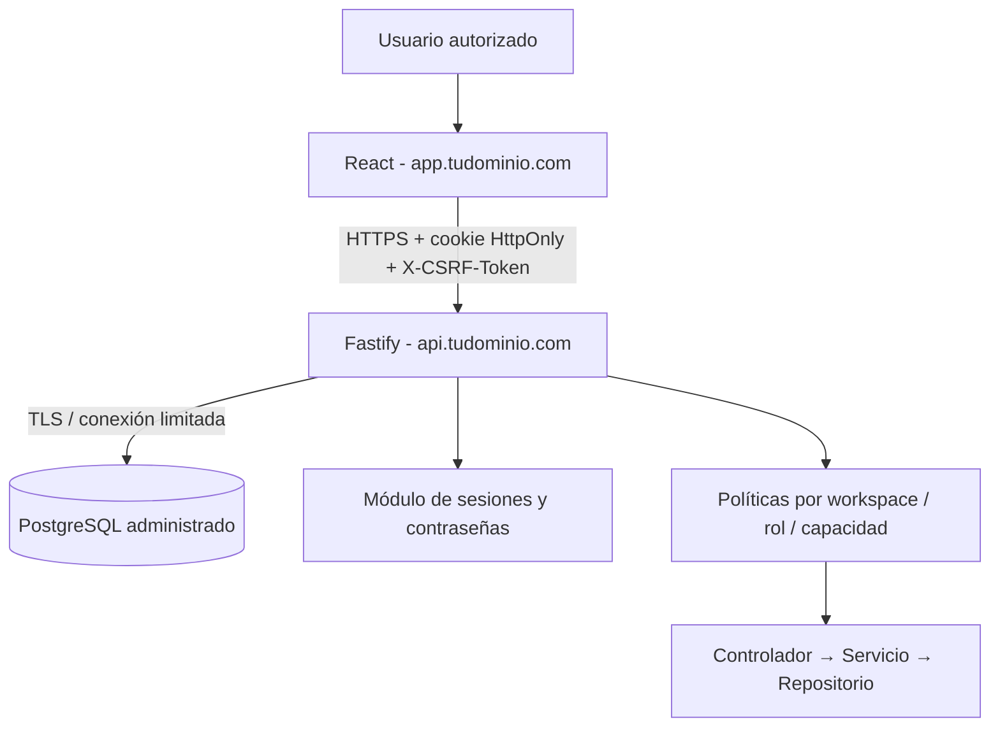

# ATLAS V4.2 · Arquitectura y seguridad

## Separación física

- Web estática y API no comparten proceso ni despliegue.
- PostgreSQL en instancia dedicada, separando DEV/PROD y credenciales.
- Sólo el backend consulta PostgreSQL. Nunca publicar `DATABASE_URL` ni secretos en frontend.
- Monorepo con workspaces npm. No requiere microservicios para separar responsabilidad de negocio.

## Autenticación

- Solo acceso cerrado (`AUTH_MODE=local`), primer administrador creado desde CLI; otros usuarios creados por ese administrador.
- `atlas_users` almacena email y hashes `scrypt`; no hay contraseñas de demostración.
- `atlas_sessions` guarda hashes de tokens opacos, validez de 12 horas y revocaciones.
- Cookie host-only `atlas_session`, `HttpOnly`, `SameSite=Lax`, `Secure` cuando NODE_ENV=production; Path `/api/v1`.
- Todas las escrituras requieren CSRF excepto `/auth/login`; petición `Origin` no autorizada se rechaza.

## Autorización

- RBAC por roles configurables en workspace; permisos granulares por operación y tipo de diagrama/elemento/relación, con scopes funcional/técnico/mixto.
- La UI ayuda al usuario, pero la **API es la fuente final de autorización**.
- Lectura parcial: filtra diagramas, nodos, relaciones, elementos y campo técnico no autorizados antes de serializar JSON.
- Escritura parcial: re-lee el documento completo dentro de una transacción, aplica los cambios autorizados y conserva los ocultos; diffs de relaciones necesitan permisos propios; verifica versión para impedir sobrescritura silenciosa.
- Roles: owner, admin, functional, technical, viewer, además de roles personalizados. El owner es inmutable.

## Capas backend

`modules/*/presentation` rutas/controladores; `application` casos de uso y políticas; `infrastructure` repositorios PostgreSQL. Las capas no dependen de Vite.

## Modelo de datos

Migración 003 agrega `atlas_users`, `atlas_sessions`, `workspace_roles`, `role_permissions`, y `workspace_members.role_id`. La migración es incremental sobre 001/002, sin borrar documentos. Los diagramas siguen en JSONB versionado para compatibilidad; normalización profunda es una evolución posterior.

## Pendientes para producción

- MFA, recuperación y rotación self-service de contraseña, seguridad y accesibilidad auditadas.
- Políticas de rate limit distribuido, auditoría global de altas, alertas y monitoreo.
- Revisión de CORS/cookies al elegir dominios finales; políticas CSP y pruebas e2e multisesión.
